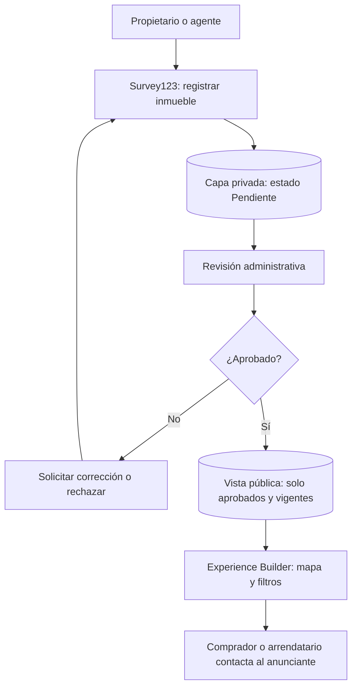

# Te colaboro en tu venta o alquiler...

**Plataforma comunitaria de propiedades georreferenciadas | Chitré, Herrera, Panamá**

> **Estado:** prototipo en desarrollo. El formulario de registro en ArcGIS Survey123 ya fue elaborado; la revisión/aprobación y el portal público están pendientes.

## Descripción

«Te colaboro en tu venta o alquiler...» es una iniciativa digital colaborativa que busca conectar a personas que ofrecen propiedades con quienes desean comprarlas o alquilarlas. Su primera cobertura será Chitré, con posibilidad de ampliarse al resto de Panamá. El servicio proyectará propiedades en un mapa interactivo y permitirá buscar por ubicación, tipo de operación, categoría de inmueble y rango de precio.

La propuesta utiliza **ArcGIS Survey123** para recibir registros, una experiencia de revisión basada en **ArcGIS Instant Apps** y servicios/capas editables con permisos restringidos para gestionar el estado de publicación, y **ArcGIS Experience Builder** para construir el sitio web público.

## Problema o necesidad

Al recorrer Chitré se observan numerosas propiedades con letreros de venta o alquiler. La información suele estar dispersa y no siempre es fácil localizar alternativas, comparar precios o contactar a los anunciantes. Esta plataforma propone reunir las ofertas en un solo espacio geográfico accesible, con información clara y registros revisados antes de su publicación. No se presupone que la plataforma por sí sola reduzca los tiempos de cierre; eso deberá evaluarse con usuarios reales.

## Público objetivo

- Propietarios y personas autorizadas para ofrecer inmuebles en venta o alquiler.
- Agentes y empresas de bienes raíces.
- Personas interesadas en comprar o arrendar propiedades.
- Colaboradores comunitarios que apoyen la difusión, documentación, diseño y validación del servicio.

## Origen

La idea surge de la observación cotidiana de numerosos anuncios de venta y alquiler en calles de Chitré, y de la oportunidad de facilitar el encuentro entre oferta y demanda mediante mapas y herramientas digitales accesibles.

## Estado actual

- **Desarrollado:** formulario inicial de registro de propiedades en ArcGIS Survey123.
- **Pendiente:** configuración y pruebas del proceso de revisión/aprobación; creación del sitio público en ArcGIS Experience Builder; diseño visual, filtros, pruebas con usuarios y estrategia de lanzamiento.
- **No implementado ni verificado:** automatización de aprobaciones, sitio público operativo, integración final, métricas de uso o resultados comerciales.

## Cómo funcionará

1. **Registro:** el anunciante completa Survey123 con ubicación, tipo de operación (venta/alquiler), categoría del inmueble, nombre, teléfono y precio sugerido. Se recomienda agregar fotografías, descripción, superficie, corregimiento, autorización de publicación y aceptación de términos.
2. **Revisión:** el registro ingresa como `Pendiente`. Un administrador valida campos, coherencia, autorización y calidad del anuncio. La interfaz de consulta puede construirse con Instant Apps; para **cambiar el estado** se requiere configurar una capacidad de edición autorizada, por ejemplo una vista/capa editable, formulario de edición o flujo administrativo complementario. No se debe asumir que cualquier plantilla de Instant Apps aprueba registros automáticamente.
3. **Publicación:** solo los registros con estado `Aprobado` y vigentes se muestran mediante una vista pública de la capa en Experience Builder.
4. **Búsqueda:** el visitante filtra propiedades por ubicación, venta/alquiler, tipo y precio, consulta una ficha y contacta al anunciante por el canal autorizado.
5. **Actualización:** el anunciante solicita correcciones o retiro del anuncio; el equipo administrativo registra cambios de estado como `Vendido`, `Alquilado`, `Retirado` o `Vencido`.

## Campos sugeridos para la capa

| Campo | Uso | Visibilidad pública sugerida |
|---|---|---|
| `tipo_operacion` | Venta / alquiler | Sí |
| `tipo_inmueble` | Casa, apartamento, terreno, local, otro | Sí |
| `precio` y `moneda` | Precio solicitado, B/. o USD | Sí |
| `provincia`, `distrito`, `corregimiento` | Ubicación administrativa | Sí |
| `ubicacion` | Punto en mapa | Sí, aproximado cuando corresponda |
| `descripcion` | Características generales | Sí |
| `fotografias` | Imágenes autorizadas | Sí, tras revisión |
| `nombre_contacto`, `telefono` | Datos de contacto | Solo con consentimiento específico; preferible canal mediado |
| `estado_publicacion` | Pendiente, Aprobado, Rechazado, etc. | No hace falta exponerlo |
| `fecha_registro`, `fecha_revision` | Trazabilidad | Administradores |
| `autorizacion_publicacion` | Consentimiento y derechos sobre el anuncio | Administradores |

**Privacidad:** no publicar información personal ni coordenadas residenciales exactas sin base legítima y consentimiento apropiado. Configurar una vista pública de solo lectura que excluya campos privados y registros no aprobados; comprobar permisos de capa, adjuntos y API antes del lanzamiento. Tener en cuenta la Ley 81 de 2019 de protección de datos personales de Panamá y sus normas aplicables.

## Cómo comenzar y colaborar

Para explorar el proyecto, leer este README, revisar las mejoras propuestas en Issues y consultar [CONTRIBUTING.md](CONTRIBUTING.md). Para proponer cambios, crear un Issue con el problema y la solución sugerida. Las personas con experiencia en ArcGIS pueden apoyar la revisión del flujo, configuración de capas/vistas, diseño responsivo de Experience Builder y pruebas de usabilidad. No se requieren credenciales privadas para contribuir con ideas, textos o prototipos.

## Ideas de diseño y difusión

- **Diseño gráfico:** identidad visual cálida y moderna inspirada en Chitré; mapa como protagonista, tarjetas con fotografías grandes, etiquetas claras «Venta» y «Alquiler», filtros visibles y navegación adaptada a teléfonos.
- **Experiencia sencilla:** botón destacado «Publicar mi propiedad», búsqueda por corregimiento, precio y categoría; fichas con información esencial y contacto autorizado.
- **Lanzamiento piloto:** invitar a propietarios, corredores y comercios de Chitré a registrar anuncios; difundir mediante códigos QR en letreros, redes sociales y aliados comunitarios.
- **Confianza:** publicar normas de participación, fecha de actualización, mecanismos para reportar anuncios incorrectos y proceso de retiro.
- **Medición:** número de anuncios recibidos/aprobados, tiempo de revisión, búsquedas y contactos (si pueden medirse de manera respetuosa con la privacidad), y satisfacción de usuarios.

## Próximos pasos

1. Revisar y completar los campos del formulario Survey123.
2. Definir roles, permisos, estados y procedimiento de validación.
3. Crear y probar la experiencia administrativa de revisión y actualización del estado.
4. Configurar la vista pública filtrada y sin datos sensibles.
5. Diseñar Experience Builder con mapa, filtros, fichas e identidad gráfica atractiva.
6. Realizar pruebas de accesibilidad y uso móvil con un grupo piloto de Chitré.
7. Desarrollar materiales de comunicación y un plan de lanzamiento local.
8. Evaluar resultados y estudiar la expansión territorial.

## Cómo se utilizó inteligencia artificial

Se utilizó ChatGPT como apoyo para organizar la documentación Markdown, mejorar la redacción, proponer un flujo técnico, identificar riesgos y redactar ideas de colaboración y divulgación. Las funcionalidades pendientes se presentan como propuestas, no como desarrollos concluidos. El responsable del proyecto debe validar las configuraciones de ArcGIS, la información y las decisiones antes de publicarlas.

## Participación

Consulta [CONTRIBUTING.md](CONTRIBUTING.md) para proponer ideas, reportar errores y colaborar mediante Issues y Pull Requests.
